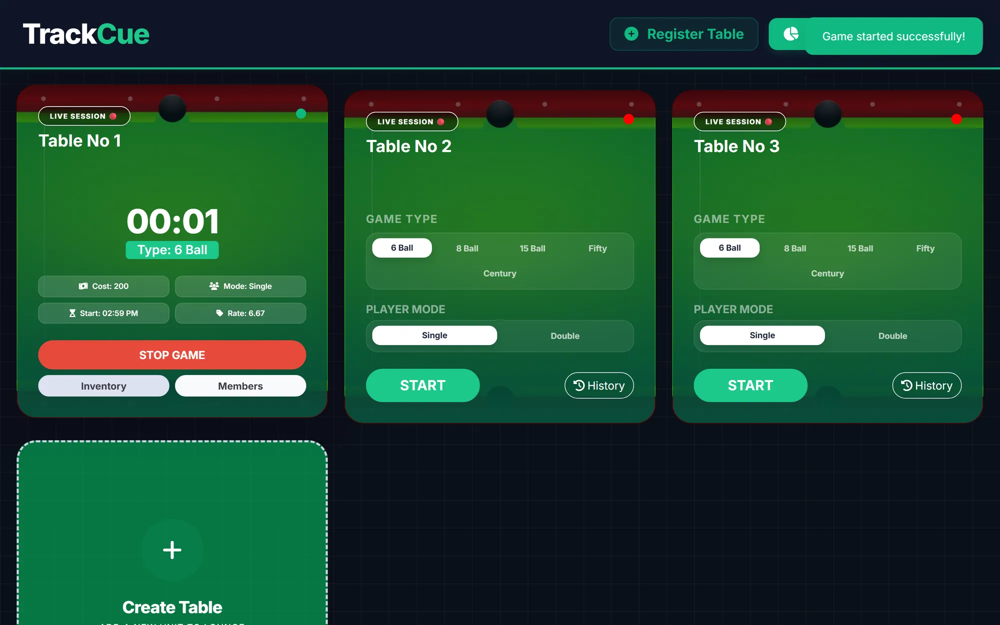
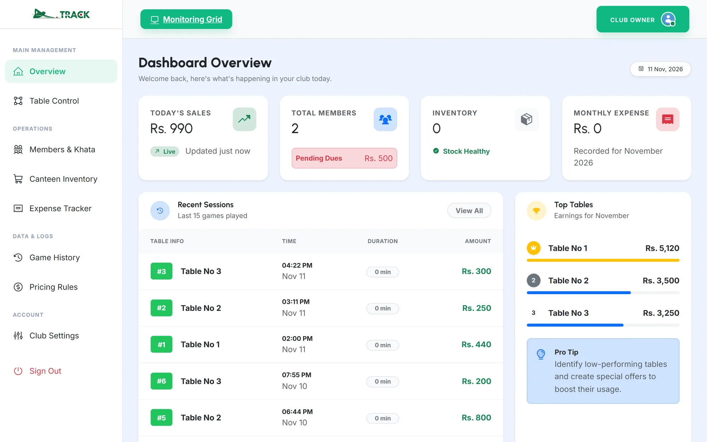
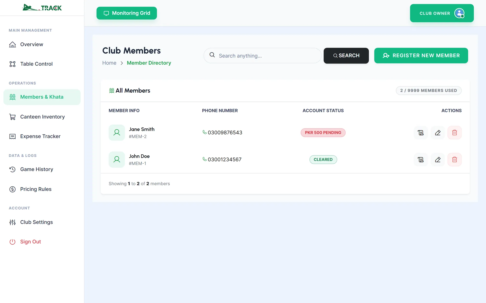
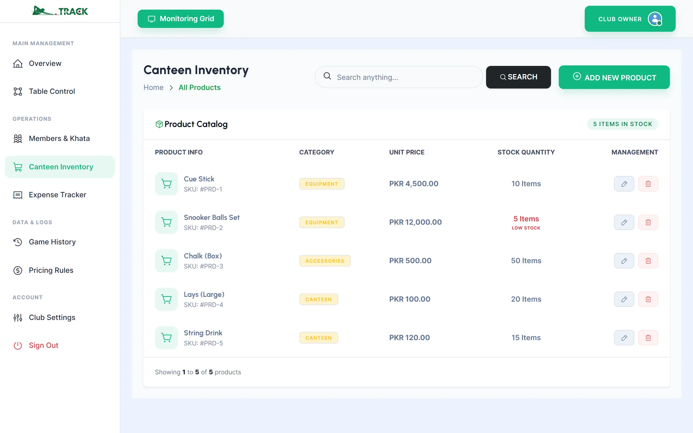
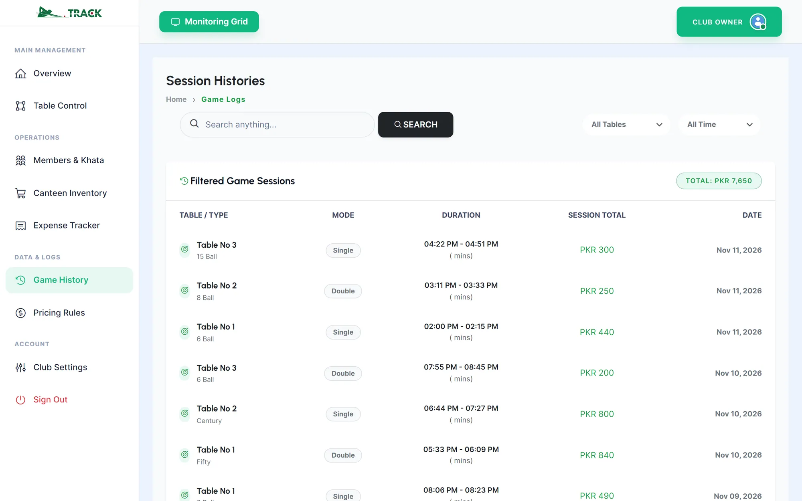
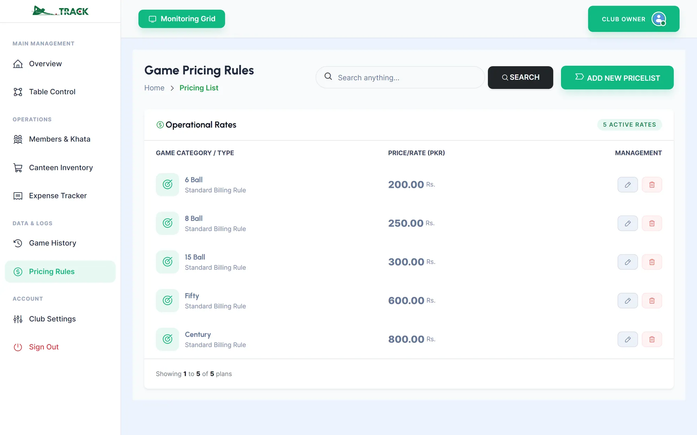

  

# Track Cue

**A multi-tenant SaaS for snooker and billiard clubs, covering live table timers, game billing, member credit, canteen stock and expenses.**

> **Portfolio showcase.** The source code is private. This repository presents the project with screenshots and a technical overview. Full case study: **[farhadnazir.com/projects/track-cue](https://farhadnazir.com/projects/track-cue/)**

| | |
|---|---|
| **Type** | Snooker club management SaaS |
| **Categories** | Web application, SaaS product, Business system |
| **Platforms** | Web |
| **My role** | Laravel developer |
| **Status** | In development |
| **Timeline** | 2026 |

## Overview

Track Cue is a subscription-based web platform built to replace the paper registers many snooker and billiard clubs rely on. Each club gets its own workspace with a live grid of tables: counter staff pick a game type and player mode, start the timer, and close the game out with automatic pricing, canteen items and cash or credit settlement.

Around the table grid sit the modules a club owner needs to run the business: a dashboard with today's sales and pending dues, a member directory with a credit ledger (khata), canteen inventory, an expense tracker, session history and per-club pricing rules. A separate super admin console manages club owners, pricing plans and subscriptions.

The product is built in Laravel and is currently in development, running locally with demo data. I was assigned to the project as its developer after a large part of the codebase was already in place, and my work covers completing the remaining modules and preparing it for production.

**Who it is for:** Snooker and billiard club owners and their counter staff, with pricing in PKR for clubs in Pakistan, plus the operator who runs the platform.

## The problem

Many clubs track tables, playing time, canteen sales and customer credit by hand. Start and end times can get missed, snacks sold during a game can be forgotten at the counter, and regular players run up credit that lives in a notebook.

The result is lost revenue, no structured record of expenses, and no clear view of which tables earn the most or which members owe money.

## The solution

Track Cue puts every table on one screen. A game starts with a tap, the timer and running cost stay visible, and ending the game produces a final bill that includes the game price, any canteen items and an optional discount. The bill is either paid in cash or added to a member's khata balance.

Because it is a multi-tenant SaaS, every club's data is kept separate and each club subscribes to a plan. Plans set limits on tables and members and decide whether premium modules such as canteen inventory and expenses are available. A daily scheduled command checks for expiring subscriptions, and owners can be sent reminder emails.

## Key features

- **Live table grid.** A full-screen grid of cards styled like snooker tables. Staff choose 6 Ball, 8 Ball, 15 Ball, Fifty or Century, single or double mode, then start a game that shows a running timer, cost, rate and start time.
- **End-of-game billing.** Stopping a game calculates the game price, adds canteen products, reduces their stock and applies any discount. The total is recorded as a cash payment or debited to a member's credit ledger.
- **Per-club pricing rules.** Each club sets its own price for every game type, charged either as a fixed amount or per minute.
- **Members and khata.** A member directory with a running balance and transaction history for each player. Owners can record payments, and members with pending dues are flagged on the dashboard.
- **Canteen inventory.** A product catalogue with categories, unit prices, stock quantities and low-stock flags. Products can be attached to a running game so they land on the same bill.
- **Owner dashboard.** Today's sales, total members and pending dues, inventory health, monthly expenses, the last 15 sessions and the top-earning tables for the month.
- **Session history and expenses.** Game logs can be filtered by table and date with a running total, and club expenses are recorded with amounts, dates and date filters.
- **Plans and super admin console.** Basic, Standard and Premium plans set table and member limits and control access to the canteen and expense modules. Clubs sign up with email verification, and the platform operator can block or activate club owners, manage plans and review subscriptions.

## Screenshots

<table>
<tr>
<td width="50%" valign="top"> The owner dashboard summarizes sales, dues, stock and table performance.</td>
<td width="50%" valign="top"> Members and khata, with pending balances visible at a glance (demo data).</td>
</tr>
<tr>
<td width="50%" valign="top"> Canteen and equipment stock, with low-stock items flagged.</td>
<td width="50%" valign="top"> Session history filtered by table and date, with a running total.</td>
</tr>
<tr>
<td width="50%" valign="top"> Each club sets its own rate for every game type.</td>
</tr>
</table>

## Architecture

Track Cue is a server-rendered Laravel 11 application on PHP 8.2 with Blade templates. Controllers are organised by domain (games, tables, members, products, expenses, pricing, subscriptions), and shared filtering and search logic lives in reusable traits.

The live table grid talks to the backend through JSON endpoints, so starting, stopping and registering tables happens without full page reloads. Data is stored through Eloquent migrations in a relational database (SQLite by default, MySQL-compatible), and email is sent over SMTP for verification, password resets and subscription reminders.

- **Tenant isolation.** Every domain table carries a club ID with cascading deletes, scoping tables, members, games, products and expenses to the club that owns them.
- **Transactional billing.** Ending a game runs inside a single database transaction: game pricing, product line items, stock decrements, discounts and the cash or ledger entry either all succeed or all roll back.
- **Flexible game records.** Games store their member list and product line items as JSON, which keeps a snapshot of who played and what was sold on each bill.
- **Plan-based feature gating.** Middleware checks the club's subscription before premium modules load and redirects owners whose plan is missing or expired.
- **Scheduled subscription jobs.** A daily Artisan command on Laravel's scheduler checks for expiring subscriptions, alongside commands for expiring plans and sending reminder emails through a dedicated mailable.
- **Role-based areas.** Session authentication with separate middleware for the super admin and club owner areas keeps the platform console and the club tools apart.
- **Resilient live timers.** The state of a running game is kept in the browser's local storage, so a page reload at the counter does not lose the timer before the game is closed and saved.

## Tech stack

`Laravel` · `PHP` · `Blade` · `Eloquent ORM` · `MySQL` · `SQLite` · `JavaScript` · `Laravel Scheduler`

## Links

- Case study: https://farhadnazir.com/projects/track-cue/

## About the developer

Built by **Farhad Nazir**, full-stack software developer in Riyadh, Saudi Arabia, and founder of [Techwine Solutions](https://www.techwinesolutions.com). I build SaaS platforms, business systems, and mobile and desktop apps.

[Portfolio](https://farhadnazir.com) · [LinkedIn](https://www.linkedin.com/in/farhadnazir) · [Email](mailto:farhadnazirksa@gmail.com) · [WhatsApp](https://wa.me/966536566380)

---

Screenshots are shown for portfolio purposes. Rights to each product and its branding belong to their owners. Screens marked "recreated" use demo data, so no real customer data appears.
